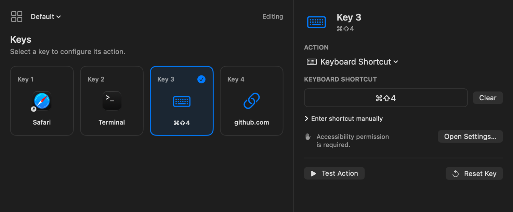
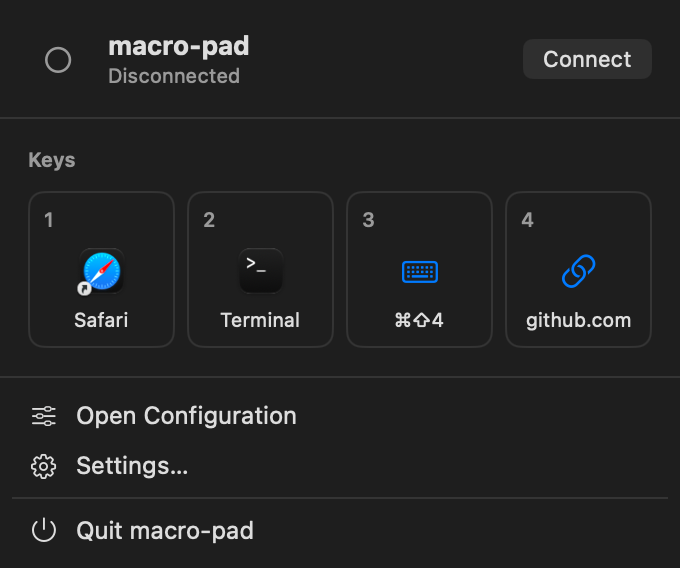
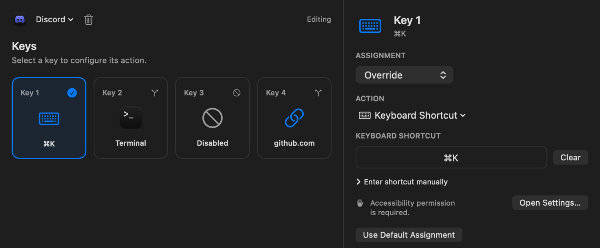
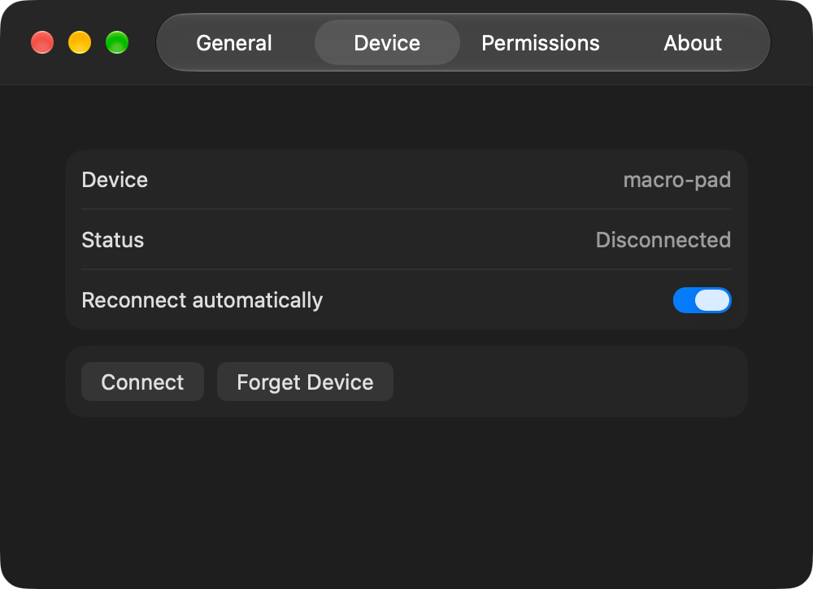

# macro-pad

macro-pad turns four mechanical switches connected to an ESP32-WROOM-32 into a configurable Bluetooth macro controller for macOS. The ESP32 sends debounced key transitions over a small custom BLE protocol; the native companion app owns assignments, permissions, persistence, and action execution.

**Verification status:** the macOS application builds, 41 Swift tests pass, and firmware compiles for PlatformIO's `esp32dev` target and Arduino CLI's `esp32:esp32:esp32` target. Manual testing on physical ESP32-WROOM-32 hardware has validated BLE connectivity, four-button input, reconnection, configured macro execution, and application integrations. The repository does not include an automated hardware acceptance suite.



## Index

- [Overview](#overview)
- [Features](#features)
- [Screenshots](#screenshots)
- [Hardware and wiring](#hardware-and-wiring)
- [How it works](#how-it-works)
- [Installation](#installation)
- [Firmware](#firmware)
- [macOS setup](#macos-setup)
- [Configuration](#configuration)
- [Development](#development)
- [Troubleshooting](#troubleshooting)
- [Limitations](#limitations)
- [Credits and license](#credits-and-license)

## Overview

The firmware detects input only. Assignments stay on the Mac, so changing a key never requires reflashing the ESP32. BLE packets contain a protocol version, message type, key identifier, transition state, and sequence number—never a command.

```text
Mechanical switch → ESP32 GPIO → debounce → BLE notification
                  → CoreBluetooth → action dispatcher → configured macOS action
```

The companion is a native SwiftUI/AppKit menu bar utility with a compact status popover, a secondary configuration window, CoreBluetooth reconnection, local Codable configuration, Settings, and a clearly labeled hardware simulation mode.

## Features

- Four independent key assignments with live pressed-state feedback
- Launch application, keyboard shortcut, HTTP(S) URL, Apple Shortcut, direct process, and no-action assignments
- Key-down-only execution with duplicate and held-key suppression
- Service-filtered BLE discovery and a remembered CoreBluetooth peripheral identifier
- Automatic reconnection with bounded exponential backoff
- Versioned atomic JSON persistence and corrupt-file preservation
- Menu bar-first lifecycle with no permanent Dock or application-switcher presence
- Launch at login through `SMAppService`
- Light, Dark, and System appearance
- Simulation for all four keys through the real event dispatcher
- Native application icons, readable URL hostnames, and action-specific key symbols

## Screenshots

| Configuration | Menu Bar |
| --- | --- |
|  |  |
| Application Profiles | Device Settings |
|  |  |

## Hardware and wiring

Required hardware:

- ESP32-WROOM-32 development board (original ESP32)
- Four MX-style mechanical switches
- Jumper wire and a shared ground

| Physical key | GPIO |
| --- | --- |
| Key 1 | GPIO 13 |
| Key 2 | GPIO 14 |
| Key 3 | GPIO 33 |
| Key 4 | GPIO 32 |

Connect one terminal of each switch to its GPIO and the other to GND. All switches share ground. Firmware uses `INPUT_PULLUP`: released is HIGH, and pressing connects the input to ground to produce LOW. No external pull-up or keyboard matrix is required.

The ESP32-WROOM-32 programming connector is serial USB, not native USB HID. macro-pad therefore uses BLE GATT rather than USB HID or BLE HID; the Mac must retain control of configurable actions and permissions.

## How it works

Firmware independently debounces each input for 20 ms and sends only stable transitions. A normal packet causes action execution only when it is a new key-down. Key-up updates state. Simultaneous keys remain independent.

After connecting, firmware waits 75 ms and sends four non-executing state-synchronization packets. A key already held when the Mac connects appears pressed but does not launch its assignment. See [the protocol specification](docs/protocol.md) for UUIDs, packet bytes, validation, and security considerations.

## Installation

> **Distribution status:** release DMGs use an ad-hoc signature to seal the completed application bundle, but they are not Apple Developer ID signed or notarized. macOS Gatekeeper may block the downloaded app or require an explicit user override. If you do not want to run an unnotarized binary, build macro-pad from source in Xcode. The project does not claim developer identity verification or Apple notarization.

Requirements:

| Component | Requirement |
| --- | --- |
| macOS | 27.0 or later |
| Xcode | Current installed Xcode capable of building the project |
| Hardware | ESP32-WROOM-32 / ESP32 Dev Module |
| Arduino CLI | 1.5.1 available during validation |
| ESP32 Arduino core | 3.3.12 for the documented Arduino path |
| NimBLE-Arduino | 2.3.7 |

Firmware validation covers both PlatformIO Core 6.2.0 with `espressif32@6.12.0` (Arduino-ESP32 2.0.17) and Arduino CLI 1.5.1 with ESP32 core 3.3.12. Both paths use NimBLE-Arduino 2.3.7.

Clone the intended repository and open the included project:

```sh
git clone https://github.com/amansanoj/macro-pad.git
cd macro-pad
open "macro-pad.xcodeproj"
```

Select the `macro-pad` scheme, choose **My Mac**, and run with **Product → Run**.

For the prebuilt release, download the DMG from [GitHub Releases](https://github.com/amansanoj/macro-pad/releases), open it, and drag `macro-pad.app` to Applications. Because the release is ad-hoc signed and unnotarized, the first launch may be blocked. Try opening the app normally first; if macOS blocks it, use the app-specific **Open Anyway** control in **System Settings → Privacy & Security**, then confirm **Open**. This approves only this app. Do not disable Gatekeeper globally, and only approve the download after verifying its published SHA-256 checksum.

## Firmware

### Arduino CLI

Install the ESP32 index, core, and NimBLE dependency:

```sh
arduino-cli config init
arduino-cli config add board_manager.additional_urls https://espressif.github.io/arduino-esp32/package_esp32_index.json
arduino-cli core update-index
arduino-cli core install esp32:esp32@3.3.12
arduino-cli lib install "NimBLE-Arduino@2.3.7"
```

Connect the ESP32, identify its serial port, compile, and upload:

```sh
arduino-cli board list
arduino-cli compile --fqbn esp32:esp32:esp32 firmware/macro-pad
arduino-cli upload -p /dev/cu.usbserial-XXXX --fqbn esp32:esp32:esp32 firmware/macro-pad
arduino-cli monitor -p /dev/cu.usbserial-XXXX --config baudrate=115200
```

Replace `/dev/cu.usbserial-XXXX` with the port printed by `arduino-cli board list`. If upload cannot enter the bootloader, hold **BOOT**, start upload, and release **BOOT** when writing begins.

In Arduino IDE, open `firmware/macro-pad/macro-pad.ino`, select **ESP32 Dev Module**, 240 MHz, 4 MB flash, default 4 MB partition scheme, PSRAM disabled, then upload. Do not select an ESP32-S3 board or USB HID option.

## macOS setup

1. Flash and power the ESP32.
2. Launch macro-pad, open its keyboard icon in the menu bar, and select **Connect**. Device discovery happens inside the app; a separate Bluetooth Settings pairing step is normally unnecessary.
3. Approve the macOS Bluetooth prompt.
4. Select **Open Configuration**, then select each key and configure an action.
5. For keyboard shortcuts, open **Settings → Permissions** and grant Accessibility access. The permission is used both to post configured shortcuts and to temporarily suppress normal key delivery while the shortcut recorder is active.

The app filters discovery by its fixed service UUID and does not trust the advertised `macro-pad` name by itself. The first BLE pairing uses Just Works and should be performed in a physically controlled environment.

## Configuration

Assignments save automatically in `~/Library/Application Support/macro-pad/configuration.json`. Application selections use bookmark data so relocated applications can usually be resolved. Removed applications produce an actionable error and can be selected again.

The existing four assignments form the permanent **Default** profile. Use the profile menu above the key preview to add an application profile; profiles are keyed by bundle identifier and each key can inherit its Default assignment, override it, or be disabled for that application. macro-pad observes foreground application activation through `NSWorkspace`, so switching applications changes the effective assignments without polling or additional permissions. Opening macro-pad preserves the last meaningful external application as the execution context while the independently selected editing profile remains unchanged.

Shell actions require explicit confirmation, an absolute executable path, and separate arguments. They use `Process` directly without shell interpolation, capture stdout/stderr/status, enforce a timeout, and never request elevation. Do not put credentials in arguments or configuration.

Older configuration files that contain a Media Control assignment remain readable and unchanged. New Media Control assignments are not offered because macOS has no supported public API for universal playback controls; use an Apple Shortcut for the target media application instead.

Enable **Simulation Mode** from the input menu in the window toolbar to run any key through the same state machine and dispatcher without hardware. Simulation is visibly separate from normal BLE operation.

## Development

Build from Xcode with **Product → Build**, or from a terminal:

```sh
xcodebuild -project "macro-pad.xcodeproj" -scheme macro-pad -destination 'platform=macOS' build
xcodebuild -project "macro-pad.xcodeproj" -scheme macro-pad -destination 'platform=macOS' test
```

The app uses only SwiftUI, AppKit, CoreBluetooth, ApplicationServices, ServiceManagement, Foundation, and public system APIs. Firmware can also be built with PlatformIO:

```sh
pio run -d firmware/macro-pad
pio run -d firmware/macro-pad -t upload --upload-port /dev/cu.usbserial-XXXX
pio device monitor --port /dev/cu.usbserial-XXXX --baud 115200
```

Release DMGs must be created with [`scripts/package-release.sh`](scripts/package-release.sh). The packager signs the completed application bundle ad hoc, requires strict signature verification before packaging, mounts the resulting DMG, and independently verifies the packaged copy. See [release packaging](docs/releasing.md) for the full process and distribution limitations.

The 41 automated checks cover protocol validation, state transitions, duplicate suppression, GPIO mapping, reconnect intent, profile resolution, persistence/migration, shortcut safeguards, URL validation, and command output, failure, cancellation, and timeout handling. Manual physical-hardware testing has covered BLE connectivity, button input, reconnection, integrations, and end-to-end macro execution; it is separate from the automated suite.

## Troubleshooting

See [docs/troubleshooting.md](docs/troubleshooting.md) for discovery, wiring, permissions, command, media-control, and recovery guidance.

## Limitations

- Physical ESP32-WROOM-32 behavior has been validated manually; there is no automated hardware acceptance suite.
- CoreBluetooth background execution and reconnection are best-effort while the app is running, not indefinite guarantees.
- BLE Just Works does not authenticate the device during first pairing; UUID and stored-identifier checks reduce accidental connections but do not defeat an active impersonator.
- macOS has no supported public API for universal system media controls. Legacy saved assignments are preserved but cannot execute; use a user-configured Apple Shortcut instead. Private APIs are not used.
- Shortcut recording uses a temporary active Quartz event tap only while the recorder has focus. Most application and WindowServer shortcuts can be filtered, but macOS does not guarantee interception of secure or system-reserved combinations. If protected recording is unavailable, use the manual shortcut editor; the app never silently falls back to unsuppressed capture.
- Profiles match applications by bundle identifier. They do not distinguish individual windows, documents, browser tabs, or websites.
- Shell configuration is local plaintext metadata. Do not store secrets in commands or arguments.

## Credits and license

Built with Apple SwiftUI, AppKit, CoreBluetooth, and Espressif Arduino support with NimBLE-Arduino.

Released under the [MIT License](LICENSE).
